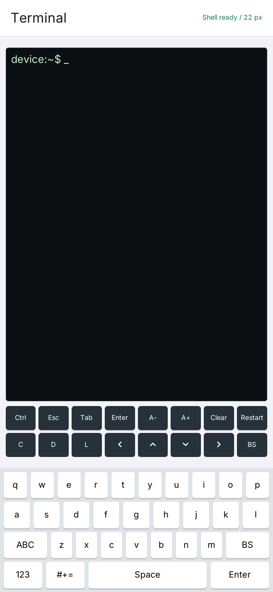

# LILYGO UI Terminal

**English** | [简体中文](README.zh-CN.md)

LILYGO UI Terminal is an interactive shell for LILYGO UI devices, built with
C++17, [LILYGO UI AppKit](https://github.com/LILYGO-UI/cm0-appkit), and LVGL 9.5.
It runs `/bin/sh` on a pseudo-terminal (PTY), interprets ANSI control sequences
with libtmt, and displays the terminal alongside a touch keyboard.

The project provides a CM0 ARM64 Linux build and an SDL2 desktop simulator
for development and testing.

## Preview

<p>
  
</p>

## Features

- **Interactive shell:** a persistent PTY session supports command-line editing,
  pipes, interactive programs, and process interruption.
- **Touch keyboard:** four modes for lowercase letters, capitals, numbers, and
  symbols, plus dedicated terminal keys and one-shot `Ctrl` combinations.
- **Session controls:** clear the local screen or restart the shell session.
- **Persistent font size:** select 14, 18, or 22 px; the next launch restores
  the selected size.
- **Responsive layout:** portrait, landscape, and compact layouts update both
  the terminal screen buffer and the PTY window size.
- **Hardware input:** forward keyboard input when the LVGL runtime supplies
  key events.

Commands inherit the UI process's permissions. An ordinary launch uses the
current user; when Launcher runs as root, the shell also runs as root.
Opening a shell does not require an SSH or console login.
See [terminal sessions and configuration](docs/02-terminal-sessions.md) for
permissions, controls, environment variables, and troubleshooting.

Terminal itself needs no network access; individual commands may need it.
The current view has no scrollback and does not render per-character ANSI
colors or text attributes. See the [compatibility notes](docs/02-terminal-sessions.md#terminal-compatibility)
before relying on full-screen applications or xterm-specific behavior.

## Development Environment

Project identity, version, and package metadata come from [`lpm.toml`](lpm.toml).
[`CMakePresets.json`](CMakePresets.json) defines the `host-simulator` and
`cm0-cross` configurations. Run all project commands from the repository root.

### Get the Source

```sh
git clone --recurse-submodules https://github.com/LILYGO-UI/terminal.git
cd lilygo-ui-terminal
```

For an existing checkout, initialize the pinned AppKit dependency:

```sh
git submodule update --init --recursive
```

AppKit is consumed directly from `third_party/cm0-appkit`; a separate AppKit
installation is not required for the simulator. Its bundled LVGL 9.5.0 archive
is used by default, with network fetching disabled in both presets. libtmt is
vendored under `third_party/libtmt`.

### Host Dependencies

Use CMake 3.21 or later (including CTest and CPack), Python 3.11 or later,
and a C/C++ compiler with C++17 support. The presets use Unix Makefiles;
AppKit also requires `patch` to apply its bundled LVGL patches. SDL2 supplies
the host display and FreeType supplies font rendering. The PTY backend needs
a POSIX host such as Linux or macOS and an available `/bin/sh`.

#### Debian 12 / Ubuntu 24.04 or Later

```sh
sudo apt update
sudo apt install build-essential cmake git pkg-config patch libsdl2-dev \
  libfreetype6-dev ca-certificates python3 python3-venv python3-pip
```

On older distributions, upgrade CMake and Python to the minimum versions above.

#### macOS

Install the Xcode Command Line Tools if needed and dependencies through
[Homebrew](https://brew.sh/). Complete the Homebrew shell setup so that `brew`
and its installed tools are on `PATH`:

```sh
xcode-select --install
brew install git cmake pkg-config patch sdl2 freetype python
```

#### LPM

CMake invokes `lpm metadata --format cmake` during configuration. Install LPM
in a project-local environment using Python 3.11 or later:

```sh
python3 -m venv .venv
. .venv/bin/activate
python -m pip install "git+https://github.com/LILYGO-UI/lpm.git"
lpm --version
```

Reactivate the environment with `. .venv/bin/activate` in each new terminal
before running `lpm`. CMake searches `.venv/bin` as well as `PATH`. An existing
LPM installation can also be selected with
`-DLPM_EXECUTABLE=/absolute/path/to/lpm` during configuration.

Check the host environment before building:

```sh
cmake --version
python --version
pkg-config --modversion sdl2 freetype2
lpm metadata --format cmake
```

### Device Cross Compiler

Skip this step when only building the desktop simulator. Device builds need
a separate AArch64 Linux cross compiler on the development machine.

**Debian / Ubuntu:**

```sh
sudo apt install gcc-aarch64-linux-gnu g++-aarch64-linux-gnu
```

**Apple Silicon macOS:**

```sh
brew install aarch64-unknown-linux-gnu
```

The BSP toolchain expects these executable names on `PATH`:

```sh
aarch64-linux-gnu-gcc --version
aarch64-linux-gnu-g++ --version
```

See [CM0BspBuilder](https://github.com/LILYGO-UI/CM0BspBuilder) for SDK host
and compiler requirements. The BSP supplies target headers and libraries but
does not install the host cross compiler.

## Build and Test

After completing the environment setup, use LPM from the repository root.
It reads the build presets and package output directory from `lpm.toml`.

### Desktop Simulator

```sh
lpm start --foreground
```

This configures and builds the simulator, then starts it in the foreground.
To reuse an existing build, run `lpm start --no-build --foreground`.
The Debug build has tests enabled and is stored in `build/host-simulator`.
Running the simulator requires a graphical desktop session. Its terminal
executes commands on the host computer as the current user; it is not an
isolated device shell.

### Tests

Configure and build the host simulator, then run all tests:

```sh
lpm test
```

| Test | Coverage |
| --- | --- |
| `terminal-core` | Preference persistence, special-key bytes, ANSI screen updates, and a real `/bin/sh` round trip |
| `terminal-view-model` | State changes and terminal command handling |
| `terminal-render-compact-portrait` | Rendering and interactions at `320 x 568` |
| `terminal-render-portrait` | Rendering and interactions at `568 x 1232` |
| `terminal-render-landscape` | Rendering and interactions at `1232 x 568` |
| `terminal-render-desktop` | Rendering and interactions at `1024 x 768` |

Render tests write `terminal-compact-portrait.ppm`, `terminal-portrait.ppm`,
`terminal-landscape.ppm`, and `terminal-desktop.ppm` under
`build/host-simulator`. Inspect these after UI changes; passing assertions
alone does not verify the visual layout. Follow the
[UI development guidelines](docs/01-user-interface.md) for acceptance requirements.

### CM0 Device Build

The device preset targets CM0 Raspberry Pi OS on AArch64, uses a Release build,
disables host tests, and sets the installation prefix to `/usr`.
Cross-compile and create the Debian package:

```sh
lpm pack
```

The first `lpm pack` (or `cmake --preset cm0-cross`) uses the
[toolchain wrapper](cmake/cm0-bsp-toolchain.cmake) to download CM0 BSP
`0.1.0`, verifies its pinned SHA-256 checksum, and extracts the sysroot to
`.cache/cm0-bsp/0.1.0/sysroot`. The first download requires access to GitHub;
later configurations reuse this cache. To change the cache location, pass
`-DCM0_BSP_CACHE_DIR=/absolute/path/to/cache` when configuring. No sibling
CM0BspBuilder checkout is required.

Cross compilation needs target libraries and headers, including FreeType
and DRM, in the SDK sysroot. Host libraries cannot substitute for missing
target dependencies.

CPack writes an ARM64 `.deb` to `dist/`. The package installs the executable,
launcher entry and icon, desktop entry, AppStream metadata, and license notices.
The target system must provide the declared dependencies: `libc6`,
`libstdc++6`, `libdrm2`, `libfreetype6`, and `lilygo-ui-appkit-dev >= 0.1.0`.
AppKit supplies shared runtime fonts on the device.

<details>
<summary>Underlying CMake commands</summary>

LPM wraps the following steps. You can also run them directly when debugging
the build configuration; LPM is still required to read project metadata.

Host build and tests:

```sh
cmake --preset host-simulator
cmake --build --preset host-simulator --parallel
ctest --preset host-simulator
```

Device build and packaging:

```sh
cmake --preset cm0-cross
cmake --build --preset cm0-cross --parallel
cpack --config build/cm0-cross/CPackConfig.cmake -B dist
```

</details>

### Troubleshooting

| Symptom | Action |
| --- | --- |
| `lpm is required to read project metadata` | Install LPM in `.venv`, put it on `PATH`, or set `LPM_EXECUTABLE`. |
| `LilyGoUI` or bundled LVGL cannot be found | Initialize the pinned AppKit submodule with `git submodule update --init --recursive`. |
| SDL2 or FreeType is missing | Install the host development packages; for cross builds, check the target sysroot. |
| Homebrew libraries are not found | Configure with `cmake --preset host-simulator -DCMAKE_PREFIX_PATH="$(brew --prefix)"`. |
| BSP download fails | Check access to GitHub releases and available disk space, then rerun configuration. |
| Launcher opens Terminal without a shell | Check PTY support and the configured shell executable, then tap `Restart`; see [session troubleshooting](docs/02-terminal-sessions.md#troubleshooting). |
| Font size is not restored | Check the UI process's configuration path and write permissions; see [configuration](docs/02-terminal-sessions.md). |

## Documentation

| Guide | Contents |
| --- | --- |
| [Terminal sessions and configuration](docs/02-terminal-sessions.md) | Controls, permissions, shell environment, preferences, and session troubleshooting |
| [Architecture overview](docs/00-overview.md) (Chinese) | Module boundaries, PTY lifecycle, threading, data flow, and failure handling |
| [UI development guidelines](docs/01-user-interface.md) (Chinese) | Layout, typography, ownership, and UI validation requirements |

Before contributing code, read the relevant guides and run `lpm test`. For UI
changes, inspect all four rendered viewports and update the preview and both
README versions to match the resulting behavior.

## License and Acknowledgments

This project is distributed under the [MIT License](LICENSE).
The interface uses [LILYGO UI AppKit](https://github.com/LILYGO-UI/cm0-appkit)
and [LVGL](https://lvgl.io/).

The ANSI parser under `third_party/libtmt` is based on
[`deadpixi/libtmt`](https://github.com/deadpixi/libtmt), commit
`1da7ba96c459672142949a529e65d730cc5bd6a1`, under its
[BSD-style license](third_party/libtmt/tmt.c#L1-L26).

The terminal behavior and control set were adapted to the independent AppKit
application architecture from the
[`k230_launcher` terminal](https://github.com/Xinyuan-LilyGO/T-Display-K230/tree/main/k230_launcher).
See the [AppKit font notices](third_party/cm0-appkit/assets/fonts/licenses/NOTICE.md)
for shared-font licensing and redistribution requirements.
