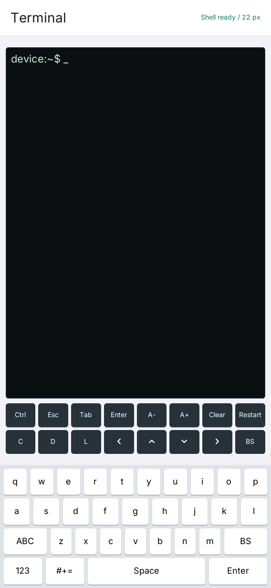

# LILYGO UI Terminal

[English](README.md) | **简体中文**

LILYGO UI Terminal 是面向 LILYGO UI 设备的交互式终端，基于 C++17、
[LILYGO UI AppKit](https://github.com/LILYGO-UI/cm0-appkit) 和 LVGL 9.5 构建。
应用通过伪终端（PTY）运行 `/bin/sh`，使用 libtmt 解析 ANSI 控制序列，
并在触摸界面中显示终端输出。

项目提供 CM0 ARM64 Linux 设备构建，以及用于开发和测试的 SDL2 桌面模拟器。

## 预览

<p>
  
</p>

## 功能

- **交互式 Shell：** PTY 支持持续会话、管道、程序中断和终端窗口尺寸通知。
- **触摸输入：** 小写、大写、数字和符号四种键盘模式，配合 `Ctrl`、`Esc`、
  `Tab`、`Enter`、方向键和退格等常用终端按键。
- **一次性 Ctrl 组合键：** 点击 `Ctrl` 后输入字母，可发送 `Ctrl+C`、`Ctrl+D`、
  `Ctrl+L` 等控制字符。
- **会话操作：** `Clear` 清空本地屏幕缓冲，`Restart` 结束旧会话并启动新 Shell。
- **响应式布局：** 适配横竖屏与紧凑屏幕；字号或视口变化时同步更新终端缓冲和 PTY 行列数。
- **字号记忆：** `A-` / `A+` 在 14、18、22 px 之间切换，并在下次启动时恢复选择。
- **硬件按键：** 当 LVGL 运行时提供键盘事件时，将按键转发给当前终端。

Shell 继承 UI 进程的权限。以普通用户启动应用时使用该用户身份；设备 Launcher
以 root 启动应用时，Shell 也以 root 运行。打开终端无需先通过 SSH 或控制台登录。

终端本身不需要网络；执行命令是否需要联网取决于命令。
运行权限、按键行为、配置路径和环境变量详见
[终端会话与配置](docs/02-terminal-sessions.md)。

当前界面没有滚动历史，也不呈现每个字符的 ANSI 颜色或样式。
依赖全屏界面或 xterm 扩展的程序需要先查看
[兼容范围说明](docs/02-terminal-sessions.md#terminal-compatibility)并验证。

## 开发环境搭建

项目标识、版本和软件包元数据由 [`lpm.toml`](lpm.toml) 提供。
[`CMakePresets.json`](CMakePresets.json) 定义了 `host-simulator` 和 `cm0-cross` 配置。
所有项目命令均在仓库根目录执行。

### 获取源码

```sh
git clone --recurse-submodules https://github.com/LILYGO-UI/terminal.git
cd lilygo-ui-terminal
```

已有仓库可使用以下命令初始化锁定版本的依赖：

```sh
git submodule update --init --recursive
```

项目直接使用 `third_party/cm0-appkit`，模拟器无需单独安装 AppKit。
默认使用其中附带的 LVGL 9.5.0 源码归档，两种预设均禁用了 LVGL 网络下载。
ANSI 解析器 libtmt 随项目存放在 `third_party/libtmt`，无需额外安装。

### 主机依赖

需要 CMake 3.21 或更高版本（包含 CTest 和 CPack）、Python 3.11 或更高版本，
以及支持 C++17 的 C/C++ 编译器。预设使用 Unix Makefiles；
AppKit 还需要 `patch` 来应用附带的 LVGL 补丁。
SDL2 提供主机显示，FreeType 负责字体渲染。
终端后端使用 POSIX PTY 与进程 API，开发环境支持 Linux 和 macOS，且需要 `/bin/sh`。

#### Debian 12 / Ubuntu 24.04 或更高版本

```sh
sudo apt update
sudo apt install build-essential cmake git pkg-config patch libsdl2-dev \
  libfreetype6-dev ca-certificates python3 python3-venv python3-pip
```

较旧发行版需要先将 CMake 和 Python 升级到上述最低版本。

#### macOS

按需安装 Xcode Command Line Tools，并通过 [Homebrew](https://brew.sh/) 安装依赖。
完成 Homebrew 的 Shell 配置，确保 `brew` 及其安装的工具位于 `PATH` 中：

```sh
xcode-select --install
brew install git cmake pkg-config patch sdl2 freetype python
```

#### LPM

CMake 在配置阶段调用 `lpm metadata --format cmake`。
使用 Python 3.11 或更高版本，在项目虚拟环境中安装 LPM：

```sh
python3 -m venv .venv
. .venv/bin/activate
python -m pip install "git+https://github.com/LILYGO-UI/lpm.git"
lpm --version
```

每次打开新终端后，先执行 `. .venv/bin/activate` 再使用 `lpm`。
CMake 会同时搜索 `.venv/bin` 和 `PATH`。
如需指定其他位置的 LPM，可在配置时传入 `-DLPM_EXECUTABLE=/absolute/path/to/lpm`。

构建前检查主机环境：

```sh
cmake --version
python --version
pkg-config --modversion sdl2 freetype2
lpm metadata --format cmake
```

### 设备交叉编译器

仅构建桌面模拟器时可跳过此步骤。设备构建需要在开发机上单独安装 AArch64 Linux 交叉编译器。

**Debian / Ubuntu：**

```sh
sudo apt install gcc-aarch64-linux-gnu g++-aarch64-linux-gnu
```

**Apple Silicon macOS：**

```sh
brew install aarch64-unknown-linux-gnu
```

BSP 工具链要求 `PATH` 中存在以下名称的可执行文件：

```sh
aarch64-linux-gnu-gcc --version
aarch64-linux-gnu-g++ --version
```

SDK 对主机和编译器的要求详见 [CM0BspBuilder](https://github.com/LILYGO-UI/CM0BspBuilder)。
BSP 提供目标平台的头文件和库，但不会安装开发机所需的交叉编译器。

## 构建与测试

完成环境搭建后，在仓库根目录使用 LPM。
它会从 `lpm.toml` 读取构建预设和打包输出目录。

### 桌面模拟器

```sh
lpm start --foreground
```

此命令会配置、构建模拟器，然后以前台模式启动。
如需复用已有构建产物，执行 `lpm start --no-build --foreground`。
Debug 构建启用测试，产物位于 `build/host-simulator`。
运行应用需要图形桌面会话，通常直接以当前普通用户启动即可。
模拟器内的终端会以当前用户身份在开发机上执行命令，可修改该用户有权限访问的文件。

### 测试

配置、构建主机模拟器并运行全部测试：

```sh
lpm test
```

| 测试 | 覆盖内容 |
| --- | --- |
| `terminal-core` | 字号持久化、特殊键序列、ANSI 解析和真实 `/bin/sh` 往返 |
| `terminal-view-model` | 展示状态和终端命令编排 |
| `terminal-render-compact-portrait` | `320 x 568` 紧凑竖屏渲染和交互 |
| `terminal-render-portrait` | `568 x 1232` 竖屏渲染和交互 |
| `terminal-render-landscape` | `1232 x 568` 横屏渲染和交互 |
| `terminal-render-desktop` | `1024 x 768` 桌面渲染和交互 |

渲染测试将 `terminal-compact-portrait.ppm`、`terminal-portrait.ppm`、
`terminal-landscape.ppm` 和 `terminal-desktop.ppm` 写入 `build/host-simulator`。
修改 UI 后应检查这些图；断言通过并不能验证视觉布局。
UI 验收要求见 [UI 开发规范](docs/01-user-interface.md)。

### CM0 设备构建

设备预设面向 AArch64 架构的 CM0 Raspberry Pi OS，使用 Release 构建，
禁用主机测试，并将安装前缀设为 `/usr`。交叉编译并生成 Debian 软件包：

```sh
lpm pack
```

首次执行 `lpm pack`（或 `cmake --preset cm0-cross`）时，
[工具链包装脚本](cmake/cm0-bsp-toolchain.cmake)会下载 CM0 BSP `0.1.0`，
校验锁定的 SHA-256，并将 sysroot 解压到 `.cache/cm0-bsp/0.1.0/sysroot`。
首次下载需要访问 GitHub，后续配置会复用缓存。
如需修改缓存位置，可在配置时传入 `-DCM0_BSP_CACHE_DIR=/absolute/path/to/cache`。
无需在相邻目录克隆 CM0BspBuilder。

交叉编译需要 SDK sysroot 中的目标平台库和头文件，包括 FreeType 和 DRM。
主机库不能替代缺失的目标平台依赖。

CPack 将 ARM64 `.deb` 输出到 `dist/`。软件包安装可执行文件、启动器条目及图标、
桌面条目、AppStream 元数据，以及应用和共享字体的许可文件。
目标系统需要提供声明的依赖：`libc6`、`libstdc++6`、`libdrm2`、`libfreetype6`
和 `lilygo-ui-appkit-dev >= 0.1.0`。AppKit 在设备上提供共享运行时字体。

<details>
<summary>底层 CMake 命令</summary>

LPM 封装了以下步骤。调试构建配置时也可以直接执行这些命令，但读取项目元数据仍需要 LPM。

主机构建与测试：

```sh
cmake --preset host-simulator
cmake --build --preset host-simulator --parallel
ctest --preset host-simulator
```

设备构建与打包：

```sh
cmake --preset cm0-cross
cmake --build --preset cm0-cross --parallel
cpack --config build/cm0-cross/CPackConfig.cmake -B dist
```

</details>

### 常见问题

| 现象 | 处理方法 |
| --- | --- |
| `lpm is required to read project metadata` | 在 `.venv` 中安装 LPM，将其加入 `PATH`，或设置 `LPM_EXECUTABLE`。 |
| 找不到 `LilyGoUI` 或附带的 LVGL | 执行 `git submodule update --init --recursive`，初始化锁定版本的 AppKit 子模块。 |
| 缺少 SDL2 或 FreeType | 安装主机开发依赖；交叉编译时检查目标 sysroot 中的依赖。 |
| 找不到 Homebrew 库 | 使用 `cmake --preset host-simulator -DCMAKE_PREFIX_PATH="$(brew --prefix)"` 配置。 |
| BSP 下载失败 | 检查 GitHub Releases 访问情况和可用磁盘空间，然后重新配置。 |
| Launcher 打开终端后没有 Shell | 检查 PTY 支持和配置的 Shell 可执行文件，然后点击 `Restart`；详见[会话故障排查](docs/02-terminal-sessions.md#troubleshooting)。 |
| 字号设置没有保存 | 检查 UI 进程的配置路径和写入权限，详见[终端会话与配置](docs/02-terminal-sessions.md)。 |

## 文档

| 指南 | 内容 |
| --- | --- |
| [架构概览](docs/00-overview.md) | 目录与模块边界、PTY 数据流、线程模型和会话生命周期 |
| [UI 开发规范](docs/01-user-interface.md) | 布局、字体、对象所有权和 UI 验证要求 |
| [终端会话与配置](docs/02-terminal-sessions.md)（英文） | 按键、运行权限、环境变量、字号配置和故障排查 |

贡献代码前应阅读相应文档，并运行 `lpm test`。涉及 UI 的修改还需检查四种视口的
渲染产物，并同步更新预览和中英文用户文档。

## 致谢与许可

本项目采用 [MIT 许可证](LICENSE)。界面使用 LILYGO UI AppKit 和 [LVGL](https://lvgl.io/)。

`third_party/libtmt` 中的 ANSI 解析器来自
[`deadpixi/libtmt`](https://github.com/deadpixi/libtmt)，对应提交
`1da7ba96c459672142949a529e65d730cc5bd6a1`，遵循其
[BSD 风格许可证](third_party/libtmt/tmt.c#L1-L26)。

终端行为和按键集合参考了
[`k230_launcher` 终端](https://github.com/Xinyuan-LilyGO/T-Display-K230/tree/main/k230_launcher)，
并适配为独立的 AppKit 应用架构。共享字体的许可和分发要求见
[AppKit 字体声明](third_party/cm0-appkit/assets/fonts/licenses/NOTICE.md)。
